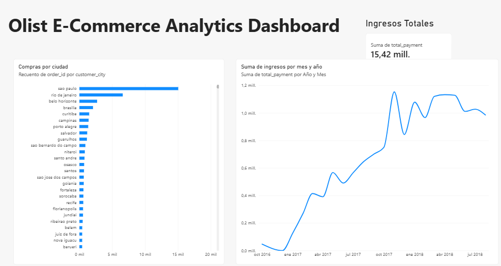

# SQL & Power BI, E-Commerce Data Analytics Pipeline.

## Project Overview
This project demonstrates an end-to-end data analytics pipeline using the Olist E-commerce dataset. The objective was to extract, transform, and visualize key business metrics to provide actionable insights regarding sales trends and geographic performance. 

## Tools & Technologies
- **Database Engine:** PostgreSQL
- **Data Processing & Modeling:** SQL (Joins, Aggregations, Views)
- **Data Visualization & BI:** Power BI

## Methodology

### 1. Data Extraction & Transformation (SQL)
To ensure optimal performance for the Business Intelligence tool, the relational data (orders, customers, payments, and products) was processed directly in the database. 
- Created a consolidated master view (`vw_ecommerce_analytics`) in PostgreSQL to avoid redundant complex joins in the visualization layer.
- The complete data modeling query can be found in the `ecommerce_analysis.sql` file.

### 2. Data Visualization (Power BI)
Connected Power BI directly to the PostgreSQL view to build an interactive dashboard tracking three main KPIs:
- **Total Revenue:** High-level metric of overall business performance.
- **Revenue by Month and Year:** Time-series analysis showcasing organic growth and seasonal peaks between 2016 and 2018.
- **Purchases by City:** Geographic distribution of the order volume to identify top-performing regions.

## Dashboard Snapshot

